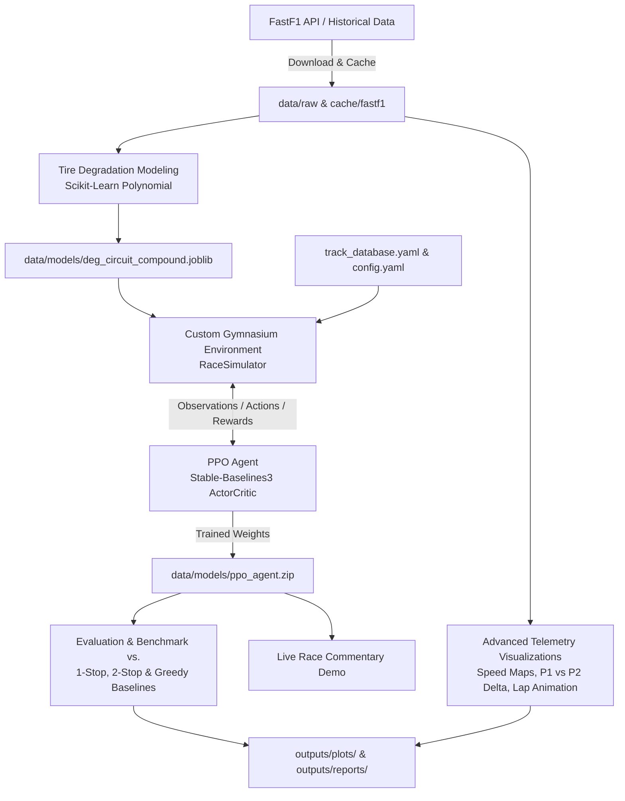

# BoxBoxRL: Formula 1 Race Strategy Predictor & Multi-Agent RL Simulation

An end-to-end **Multi-Agent Reinforcement Learning (MARL)** race strategy engine and high-fidelity telemetry visualizer for Formula 1. 

Instead of relying on rigid, pre-programmed pit window heuristics, **BoxBoxRL** combines historical telemetry extracted via `FastF1`, physics-calibrated tire degradation regression models, and deep reinforcement learning (`Stable-Baselines3` PPO). An autonomous agent competes in a multi-car simulated Grand Prix to master the undercut, manage tire degradation cliffs, exploit Safety Car / Virtual Safety Car timings, and balance the pit lane transit penalties against the track position.

---

## Table of Contents
- [Key Features](#-key-features)
- [System Architecture](#-system-architecture)
- [Real Data vs. Simulation Modeling](#-real-data-vs-simulation-modeling)
- [Project Directory Structure](#-project-directory-structure)
- [Hardware & Acceleration (CPU vs. GPU)](#-hardware--acceleration-cpu-vs-gpu)
- [Installation & Setup](#-installation--setup)
- [Running the Pipeline](#-running-the-pipeline)
  - [Automated Master Script](#1-automated-master-script-recommended)
  - [Step-by-Step Execution](#2-step-by-step-execution)
- [Scripts & Capabilities Breakdown](#-scripts--capabilities-breakdown)
- [Configuration & Track Database](#-configuration--track-database)
- [Reinforcement Learning Mechanics & Reward Design](#-reinforcement-learning-mechanics--reward-design)
- [Outputs & Generated Artifacts](#-outputs--generated-artifacts)
- [Running Unit Tests](#-running-unit-tests)
- [License](#-license)

---

## Key Features

- **Real-World Telemetry Pipeline**: Automatically downloads and caches official Formula 1 session telemetry, lap deltas, tire compound stints, and weather conditions via `FastF1`.
- **Compound Degradation Modeling**: Fits polynomial regression curves to empirical lap times per circuit and compound (Soft, Medium, Hard), isolating fuel burn-off effects from pure tire wear.
- **Custom Gymnasium Environment**: Implements a gym-standard `RaceSimulator` supporting dynamic dirty-air traffic penalties, stochastic Safety Car (SC) and Virtual Safety Car (VSC) deployments, and compound regulations.
- **Deep Reinforcement Learning (PPO)**: Trains an actor-critic agent capable of reactive strategic decision-making (Push, Conserve, Box for Soft / Medium / Hard) in response to changing race states.
- **Telemetry & Track Visualizations**:
  - Speed-colored circuit heatmaps with dynamic corner apex annotations.
  - Multi-panel telemetry comparisons between P1 and P2 (Speed, Throttle, Brake, Gear, RPM, and Time Delta).
  - Animated lap-by-lap telemetry traces and race replay gap-to-leader charts.
- **Live Terminal Commentary Demo**: An interactive, lap-by-lap simulation viewer displaying real-time overtakes, tire lives, pit stop stationary durations, and position deltas.

---

## System Architecture



---

## Real Data vs. Simulation Modeling

To preserve realism while maintaining RL training speed, BoxBoxRL blends empirical F1 telemetry with stochastic simulation assumptions:

| Parameter | Type | Source & Methodology |
| :--- | :--- | :--- |
| **Lap Times & Base Pace** | **Real Data** | Extracted directly from official FastF1 historical session laps. |
| **Tire Compounds** | **Real Data** | Real Pirelli allocations (Soft, Medium, Hard) used during Grand Prix weekends. |
| **Tire Degradation Curves** | **Model Estimate** | Polynomial regression fitted to lap times vs. tire age, adjusted for fuel mass burn. |
| **Pit Stationary Time** | **Real Data** | Calibrated to real-world team stop times (~2.2s - 3.5s). |
| **Pit Lane Loss Time** | **Model Estimate** | Speed-limited pit lane transit delta based on circuit geometry (e.g. ~24s at Monza). |
| **Safety Car Frequency** | **Simulation Model** | Calibrated Poisson / per-lap probability distribution derived from historical track data. |
| **SC / VSC Delta** | **Simulation Model** | Lap time slowdown factor (~40% under SC, ~30% under VSC) providing cheap pit stop windows. |
| **Dirty Air / Traffic Penalty**| **Simulation Model**| Time penalty applied when within 1.0s behind a rival without DRS advantage. |
| **Fuel Burn Effect** | **Simulation Model** | Linear weight reduction penalty (~0.035s to 0.055s per kg of fuel burned each lap). |

---

## Project Directory Structure

```text
F1_Race_Strategy_Predictor/
├── config.yaml                     # Primary configuration (circuit, season, PPO hyperparams)
├── track_database.yaml             # Track telemetry configs (laps, pit loss, tire degradation baselines)
├── requirements.txt                # Python package dependencies
├── run_pipeline.ps1                # Automated end-to-end master execution pipeline
├── pytest.ini                      # Pytest runner configuration
│
├── cache/                          # FastF1 disk cache to prevent network rate-limiting
│   └── fastf1/
├── data/
│   ├── raw/                        # Historical session telemetry from FastF1
│   ├── processed/                  # Cleaned, standardized lap-level datasets
│   └── models/                     # Saved joblib degradation models & ppo_agent.zip
│
├── outputs/                        # Generated charts, animations, logs, and summaries
│   ├── animations/                 # MP4/GIF animations of fastest laps
│   ├── plots/
│   │   ├── degradation/            # Tire wear curves by compound and circuit
│   │   ├── races/                  # Gap-to-leader strategy progression charts
│   │   └── telemetry/              # Track speed heatmaps & P1 vs P2 telemetry deltas
│   └── reports/                    # CSV evaluation results and performance metrics
│
├── logs/                           # TensorBoard training metrics & system logs
│   └── tensorboard/
│
├── src/                            # Modular core source code
│   ├── data_pipeline/              # FastF1 data extraction, caching, and distance interpolation
│   ├── models/                     # Polynomial tire degradation & lap time regressors
│   ├── environment/                # Gymnasium environment & multi-car RaceSimulator engine
│   ├── agents/                     # PPO agent wrapper, actor-critic policy configuration
│   ├── evaluation/                 # Benchmark comparison suite vs. rule-based strategies
│   └── visualization/              # Matplotlib speed map, telemetry panel, and lap animator tools
│
├── scripts/                        # Executable CLI tools (10 distinct steps)
│   ├── download_data.py            # Step 1: Ingest FastF1 session telemetry
│   ├── fit_degradation.py          # Step 2: Fit ML tire degradation curves
│   ├── train_agent.py              # Step 3: Train PPO policy with Gymnasium
│   ├── evaluate_agent.py           # Step 4: Evaluate vs. 1-Stop/2-Stop baselines
│   ├── visualize_race.py           # Step 5: Plot race evolution & pit gaps
│   ├── demo.py                     # Step 6: Live text-commentary race simulation
│   ├── plot_speed_map.py           # Step 7: Render circuit track speed heatmap
│   ├── compare_telemetry.py        # Step 8: Multi-panel P1 vs P2 telemetry comparison
│   ├── animate_lap.py              # Step 9: Render dynamic fastest lap animation
│   └── top_10_drivers.py           # Step 10: Display official qualifying & race classifications
│
└── tests/                          # 28+ unit tests verifying data, models, and simulation logic
```

---

## Hardware & Acceleration (CPU vs. GPU)

The PPO agent uses a Multi-Layer Perceptron (`MlpPolicy`). For RL environments where stepping the simulator environment is the bottleneck:

- **CPU Training (Default & Highly Recommended)**: Python environment execution and rollout buffer collection operate with minimal overhead on modern multi-core CPUs.
- **GPU Training (NVIDIA CUDA)**: Supported via `device: auto`. If you have an NVIDIA GPU (e.g. RTX 3050+) with CUDA drivers installed, PyTorch will leverage CUDA acceleration during gradient updates.

### PyTorch GPU (CUDA 13.2) Setup:
```powershell
pip install torch torchvision torchaudio --index-url https://download.pytorch.org/whl/cu132
```

Verify CUDA recognition:
```powershell
python -c "import torch; print('CUDA Available:', torch.cuda.is_available()); print('Device:', torch.cuda.get_device_name(0) if torch.cuda.is_available() else 'CPU')"
```

---

## Installation & Setup

### 1. Prerequisites
- **Python**: 3.10, 3.11, or 3.12 (64-bit)
- **Git** installed on your system
- Optional: `ffmpeg` for exporting lap animations (`.mp4`)

### 2. Clone the Repository
```bash
git clone https://github.com/YashPatel2777/BoxBoxRL.git
cd BoxBoxRL
```

### 3. Create & Activate a Virtual Environment
- **Windows (PowerShell)**:
  ```powershell
  python -m venv venv
  .\venv\Scripts\Activate.ps1
  ```
- **macOS / Linux**:
  ```bash
  python3 -m venv venv
  source venv/bin/activate
  ```

### 4. Install Dependencies
```bash
pip install --upgrade pip
pip install -r requirements.txt
```

### 5. Configure Python Path
Ensure your shell recognizes the root repository directory:
- **Windows (PowerShell)**:
  ```powershell
  $env:PYTHONPATH="."
  ```
- **macOS / Linux**:
  ```bash
  export PYTHONPATH="."
  ```

---

## Running the Pipeline

### 1. Automated Master Script (Recommended)
Run all 10 pipeline steps sequentially with a single command:

```powershell
.\run_pipeline.ps1
```

### 2. Step-by-Step Execution

#### Step 1: Download Historical Telemetry
Downloads session data from FastF1 for the circuit specified in `config.yaml` and populates the local disk cache:
```bash
python scripts/download_data.py
```

#### Step 2: Fit Tire Degradation Models
Trains polynomial regressors to predict compound wear and saves `.joblib` models to `data/models/`:
```bash
python scripts/fit_degradation.py
```

#### Step 3: Train the RL Agent
Initializes the Gymnasium environment and trains the PPO agent for the configured timesteps (default: 500,000 steps):
```bash
python scripts/train_agent.py
```
*Tip: Monitor live learning curves with TensorBoard:*
```bash
tensorboard --logdir=logs/tensorboard
```

#### Step 4: Evaluate Against Baselines
Simulates benchmark races comparing the trained RL policy against standard fixed strategies:
- **1-Stop Medium ➔ Hard**
- **2-Stop Soft ➔ Medium ➔ Hard**
- **Greedy / Reactive Pit Stop Heuristic**
```bash
python scripts/evaluate_agent.py
```

#### Step 5: Visualize Race Evolution
Generates high-resolution gap-to-leader strategy charts in `outputs/plots/races/`:
```bash
python scripts/visualize_race.py
```

#### Step 6: Run Live Race Demo
Simulates a real-time Grand Prix with live ASCII terminal commentary, tracking pit windows and safety cars:
```bash
python scripts/demo.py
```

#### Step 7: Generate Circuit Speed Map
Renders a 2D track map colored by cornering and straight-line speeds with apex numbers:
```bash
python scripts/plot_speed_map.py
```

#### Step 8: Compare P1 vs. P2 Telemetry
Extracts the fastest qualifying or race laps of the winner and runner-up, synchronizes them over a uniform distance axis, and plots speed, throttle, braking, gear, and time delta:
```bash
python scripts/compare_telemetry.py
```

#### Step 9: Animate Fastest Lap
Generates a dynamic visual representation of car telemetry traversing the track:
```bash
python scripts/animate_lap.py
```

#### Step 10: Fetch Top 10 Classifications
Pulls official qualifying and race classification tables from the latest season:
```bash
python scripts/top_10_drivers.py
```

---

## Configuration & Track Database

### `config.yaml`
Control global runtime settings, active circuit, seasons, and PPO hyperparameters:

```yaml
data:
  circuit: "Italian Grand Prix"       # Active GP (e.g. "Monza", "Silverstone", "Spa")
  seasons:
    - 2022
    - 2023
    - 2024

simulation:
  num_cars: 5                        # Number of competing cars in the simulation
  
safety_car:
  enabled: true                      # Enable random Safety Car deployments
  
vsc:
  enabled: true                      # Enable Virtual Safety Car deployments

training:
  algorithm: "PPO"
  total_timesteps: 500000
  learning_rate: 0.0003
  batch_size: 64
  gamma: 0.99
  gae_lambda: 0.95
  clip_range: 0.2

telemetry:
  session_type: "Q"                  # 'R', 'Q', 'FP1', 'FP2', 'FP3', 'S', 'SQ'
  distance_interpolation_step: 5.0   # Metric interpolation step (meters)
  plot_theme: "dark_background"
```

### `track_database.yaml`
Contains circuit-specific metadata such as total laps, pit lane transit delta, baseline lap times, and base degradation rates across the Formula 1 calendar.

---

## Reinforcement Learning Mechanics & Reward Design

The PPO agent observes the complete operational state of the car and competitor field on every lap:

### Observation Space
- Current Lap & Race Progress (`lap / total_laps`)
- Track Position (`1st` through `num_cars`)
- Current Compound (One-hot encoded: Soft, Medium, Hard)
- Current Tire Age & Estimated Degradation Percentage
- Gap to Leader and Gap to Car Ahead / Behind (seconds)
- Pit Lane Delta & Track Status (Green, Yellow, SC, VSC)
- Pit Stop Counter & Mandatory Two-Compound Rule Status

### Action Space (Discrete)
- `0`: **Stay Out** (Maintain target pace)
- `1`: **Stay Out & Push** (Sacrifice tire life for immediate lap pace)
- `2`: **Stay Out & Conserve** (Manage degradation, accept slightly slower lap)
- `3`: **Box for Soft** (Trigger pit stop, fit fresh Soft compound)
- `4`: **Box for Medium** (Trigger pit stop, fit fresh Medium compound)
- `5`: **Box for Hard** (Trigger pit stop, fit fresh Hard compound)

### Reward Function Structure
- **Position Gain/Loss**: $+2.0$ for each overtake completed; $-2.5$ for being overtaken.
- **Final Finishing Position**: Exponential reward rewarding P1 through podium finishes.
- **Pit Lane Overhead Penalty**: Penalizes unnecessary stops (~20-25s transit cost).
- **Mandatory Two-Compound Rule Enforcement**: Imposes a heavy terminal penalty if the car finishes the race without utilizing at least two distinct dry compounds (preventing the 0-stop reward-hack).
- **Safety Car Opportunism**: Strategic incentive for pitting while the field is neutralized under SC/VSC due to the halved pit time loss.

---

## Outputs & Generated Artifacts

Generated assets are systematically organized into the `outputs/` directory:

| Directory | Content Description |
| :--- | :--- |
| `outputs/plots/degradation/` | Fitted tire wear curves (lap time degradation vs. tire age per compound). |
| `outputs/plots/races/` | Strategy comparison graphs showing gap-to-leader progression across race laps. |
| `outputs/plots/telemetry/` | Speed track maps with corner numbers and P1 vs P2 multi-panel telemetry deltas. |
| `outputs/animations/` | Lap animations and trajectory files (.mp4 / .gif). |
| `outputs/reports/` | Detailed CSV files logging race finishing times, stint lengths, and baseline comparisons. |
| `logs/tensorboard/` | Training logs containing policy loss, value loss, entropy, and episode reward mean. |

---

## Running Unit Tests

The test suite validates data ingestion, degradation regression accuracy, simulator physics, and RL environment constraints:

```bash
pytest -v
```

To run a specific test suite:
```bash
pytest tests/test_simulator.py -v
pytest tests/test_degradation_model.py -v
pytest tests/test_environment.py -v
```

---

## License

This project is licensed under the [MIT License](LICENSE). Telemetry and timing data are fetched for educational, research, and non-commercial simulation purposes via the `FastF1` open-source library. Formula 1 and related marks are trademarks of Formula One Licensing B.V.
